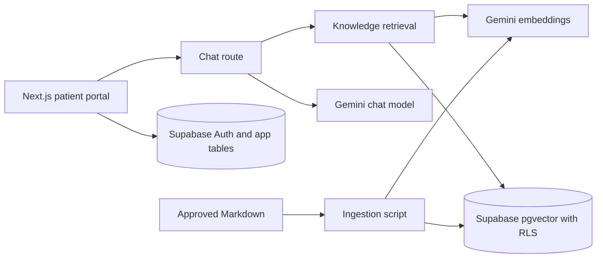

# CareFlow

CareFlow is a synthetic-data demo of an AI clinic receptionist and patient portal. It combines a Next.js interface, Supabase authentication and appointment data, and a Gemini-powered retrieval augmented generation (RAG) search over a curated Markdown knowledge corpus. Do not enter real patient or other sensitive personal information: chat messages and retrieved context are sent to Google for model processing.

## Architecture



## Retrieval evaluation

The fixed synthetic evaluation corpus has 50 cases: 37 answerable, 7 unsupported cases with target documents, 3 off-topic unanswered cases, and 3 near-domain unanswered cases. Hit@4 and MRR are measured over the 44 cases with expected documents; no-match accuracy is measured over the 6 unanswered cases. At the selected cosine-similarity cutoff of `0.67`, document-level Hit@4 is 38/44 (86.4%), MRR is 0.775, and no-match accuracy is 5/6 (83.3%): 3/3 off-topic and 2/3 near-domain. At `0.65`, Hit@4 was 41/44 (93.2%) and MRR was 0.816, while no-match accuracy was 3/6 (50%). The selected cutoff trades some retrieval recall for fewer unsupported matches. These scores describe this fixed synthetic dataset, not a held-out evaluation set.

Run the retrieval evaluation with `npm run rag:evaluate` (or `node scripts/evaluate-knowledge.mjs`). It sweeps the configured thresholds; pass `-- --thresholds 0.60,0.65,0.67,0.70` or `-- --output report.json` to choose a sweep or save a JSON report. Direct mode requires `NEXT_PUBLIC_SUPABASE_URL`, `NEXT_PUBLIC_SUPABASE_ANON_KEY`, and `GEMINI_API_KEY`, plus either an authenticated synthetic account token in `EVAL_ACCESS_TOKEN` or `EVAL_EMAIL` and `EVAL_PASSWORD`. It does not require a service-role key. For an operator-run, offline retrieval path, `--prepare-queries C:\absolute\new-query-vectors.json` creates Gemini query vectors, which an operator can pass to the read-only Supabase MCP RPC; score returned rows with `--results C:\absolute\rpc-results.json`. No credentials are needed to score `--results`.

To separately check supplied model answers, use `--answers C:\absolute\answers.json`. The file can include optional `fact_checks` boolean labels, one human judgment per expected fact. The tool also reports deterministic phrase checklist matches; it does not generate answers or perform automated semantic/factual scoring.

Four live Gemini 3.1 Flash-Lite responses using retrieved hosted passages passed human review of expected facts (4/4); literal phrase checklist checks passed 50.0%. This is a small sample, not a suite-wide answer-accuracy result. A live scheduling tool roundtrip through the same Next.js app also passed against a mock database. The repository's Gemma 4 model setting returned upstream HTTP 503 during verification; set `GEMINI_CHAT_MODEL=gemini-3.1-flash-lite` for the verified local configuration.

| Metric | Result |
| --- | --- |
| Hit@4 at 0.67 | 38/44 (86.4%) |
| MRR at 0.67 | 0.775 |
| No-match accuracy at 0.67 | 5/6 (83.3%); off-topic 3/3, near-domain 2/3 |
| Live answer fact review | 4/4 in a small sample; not suite-wide accuracy |
| Literal phrase checklist | 50.0%; not a semantic accuracy metric |

## Local setup

Install dependencies with `npm ci`, then create `.env.local` with the application values:

```dotenv
NEXT_PUBLIC_SUPABASE_URL=https://your-project.supabase.co
NEXT_PUBLIC_SUPABASE_ANON_KEY=your-anon-or-publishable-key
GEMINI_API_KEY=your-gemini-api-key
GEMINI_CHAT_MODEL=gemini-3.1-flash-lite
```

The privileged ingestion command also needs `SUPABASE_SERVICE_ROLE_KEY`. Keep that key in a trusted operator environment only. Never add it to a `NEXT_PUBLIC_` variable, browser code, source control, or a deployment exposed to clients.

Create `GEMINI_API_KEY` in Google AI Studio. `GEMINI_API_KEY` is server-side only and must never use a `NEXT_PUBLIC_` prefix. `GEMINI_CHAT_MODEL` selects the chat model; the verified local setting is `gemini-3.1-flash-lite`.

Apply `supabase/migrations/20261118103119_knowledge_base.sql` through the project's reviewed migration process before ingesting documents. The hosted app schemas already exist; this migration adds only the RAG knowledge corpus and assumes the existing application schema. The migration installs `vector` in `extensions`; if the extension already exists in a different schema, it stops with a resolution hint. Inspect its dependencies before relocating it. This migration does not move or drop an existing extension automatically.

Apply `supabase/migrations/20261118112705_knowledge_chunks_hnsw_cosine.sql` as the follow-up migration to add the cosine HNSW index and update the retrieval function. The index supports larger corpora; for the small demo corpus it is a scale choice, not a quality feature. Ingestion retains the full source text for citations while excluding the repeated fictional portfolio disclaimer paragraph from Gemini embedding input.

Run the app locally with `npm run dev`. Run repository checks with `npm run lint` and `node --test`.

## Ingest approved knowledge

Create one UTF-8 `.md` file per approved source. Add this front matter, followed by the source content:

```markdown
---
id: clinic-appointments
title: Appointment information
source_url: https://clinic.example.org/appointments
category: clinic operations
---

## Booking

Use the clinic's approved appointment instructions here.
```

IDs use lowercase letters, digits, and hyphens. Titles are limited to 200 characters and source URLs must be HTTPS. `category` is optional and, when present, is included in each chunk's embedding input; it remains part of the content hash without a database schema change. Headings are retained with each chunk. Content is split into chunks of at most 1,200 characters, with at most 100 chunks per document. Embeddings use `models/gemini-embedding-2` at 768 dimensions and include the document title.

Similarity search currently starts with a match threshold of `0.65`. Treat this as an initial calibration value: evaluate retrieval against the approved corpus and representative relevant and unrelated questions before changing it.

Preview parsing without secrets or network access:

```sh
npm run knowledge:ingest -- --dry-run path/to/approved-markdown
```

Publish or update after verifying the source and environment:

```sh
npm run knowledge:ingest -- path/to/approved-markdown
```

The hash-based check skips unchanged published documents. Publishing replaces a document's metadata and chunks in one database transaction, so a failed replacement leaves the previous version intact. A directory is processed one document at a time; each document is atomic, but the directory as a whole is not. Re-running after a partial directory failure safely resumes unchanged documents.

Retire a source that is no longer approved or current:

```sh
npm run knowledge:ingest -- --retire clinic-appointments
```

Retirement unpublishes the document and removes its chunks in one transaction. It is intentionally explicit: deleting a Markdown file from disk does not delete or unpublish its database record.

## Synthetic fixtures and demo corpus

`knowledge/examples/clinic-check-in.md` remains available as a single fabricated test fixture. The publishable fictional corpus is in `knowledge/demo/`; it is not approved clinical guidance or a production source. Preview the single fixture or full demo corpus with `--dry-run`. Publishing requires the explicit `--allow-demo` opt-in and must only be used against a disposable test project:

```sh
npm run knowledge:ingest -- --dry-run knowledge/examples
npm run knowledge:ingest -- --dry-run knowledge/demo
```

Fictional corpus documents use `demo-` IDs and reserved canonical source URLs of the form `https://careflow.example/knowledge/<same-id>`. Chat citations resolve these sentinel URLs to authenticated-session source pages at `/knowledge/<id>`; ordinary HTTPS source citations remain external links. The detail page shows only published `demo-` documents visible through the caller's Supabase session and RLS.

`knowledge/evaluation/` is quarantined and contains hard negative evaluation documents with `eval-` IDs. They are rejected from every ingest attempt before embedding, including mixed attempts. Keep them out of all publish flows.

To prepare demo embeddings for an operator using the existing reviewed publish RPC, use the opt-in and an absolute destination outside this repository. This calls the existing Gemini embedding stage, performs no database write, refuses to overwrite the destination, and prints no key material:

```sh
npm run knowledge:ingest -- --allow-demo --prepare C:\temp\careflow-demo-prepared.json knowledge/demo
```

The resulting JSON contains `format`, `model`, and `dimensions`, plus `documents` with `id`, `title`, `source_url`, `content_hash`, and ordered `chunks` (`ordinal`, `heading`, `content`, `embedding`). Handle this file as sensitive operator output and remove it after the publish workflow is complete.
